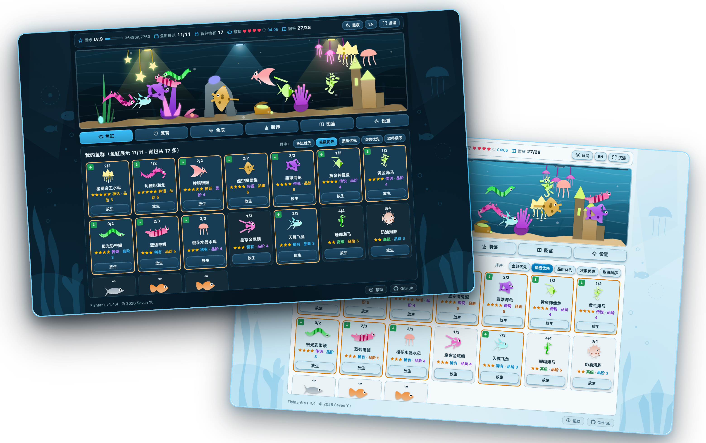

# Fishtank · 桌面放置水族箱

**在浏览器或桌面上养一缸安静游动的深海小鱼。**  
*A cozy idle aquarium for your browser and desktop — raise, breed, merge, and collect 28 marine creatures.*

---

## 预览 / Preview

  

---

## 产品简介 / About Fishtank

**Fishtank** 是一款灵感源自 Steam 桌面放置游戏《[PC FISH: Taskbar Aquarium](https://store.steampowered.com/app/4842670/PC_FISH_Taskbar_Aquarium/?l=tchinese)》的网页端放置养成水族箱。无需注册登录、即开即玩，既可以在工作间隙体验配对繁育与全图鉴收集的乐趣，也可以一键切换至**全屏沉浸模式**，伴随轻柔的海洋白噪音与 Lo-Fi 音乐作为桌面生态屏保。

---

## 玩法与亮点 / Highlights

### 🐠 28 种独立海洋生物与 5 阶幻彩变种
- 收录从初始金鱼、月光水母、黄金海马、蓝弧电鳗、天翼飞鱼到神话级**皇冠冥河水母**、**幻彩叶海龙**、**深海绿海龟**等 **28 种海洋生物**。
- 每种生物均拥有专属的生理轮廓与游动姿态（鱼群摆尾、水母脉冲舒缩、海马直立点头、海龙拟态漂浮、蝠鲼展翼滑翔）。
- 除初始鱼外，每种鱼拥有 **品阶 1 至 品阶 5** 五种色相变种，高品阶不仅外观独特，还可提供最高 **2.0x 经验加成**。

### 💕 亲代配对繁育与 10 合 1 聚变合成
- **爱心繁育**：消耗 1 颗爱心（每 7 分钟自动恢复 1 颗，上限 5 颗）即可让两条成年鱼配对孵化后代。双亲星级越高，越容易孵化出高星级稀有鱼种；双亲品阶越高，后代遗传高品阶的概率越大。
- **10 合 1 合成**：将 10 条低星级或繁育次数耗尽（`0/n`）的鱼进行聚变合成，**100% 升级为高一星级的新鱼**，并 **100% 继承 10 条材料鱼中的最高品阶**（支持一键自动按“1 高品阶 + 9 低品阶”最优策略选鱼）。
- 完整繁育概率与等级数值表可查阅游戏内「帮助」面板或 [《游戏帮助与数值说明》](docs/BALANCE.md)。

### 🪸 18 件可拖拽海底造景与昼夜灯光系统
- 随着鱼缸等级从 **Lv.1 提升至 Lv.10**，鱼缸展示容量与装饰摆放槽位同步从 **3 个扩展至 12 个**，逐步解锁翠绿海草、鹿角珊瑚、沉船宝箱、海底城堡、深海神像以及星芒吊灯、霓虹水母灯等 **18 件非对称造景**。
- **自由拖拽布置**：直接在鱼缸画面中按住任意装饰即可左右拖动调整位置，打造独一无二的海底景观。
- **自动 / 日间 / 黑夜模式**：黑夜模式下，鱼缸顶部的氛围射灯与顶挂彩灯会自动点亮，向深海水域投射柔和的体积光束。

### 🫧 鲜活的鱼缸互动
- **点水投喂**：点击鱼缸空白水域可一颗颗撒下鱼食，附近的鱼会争相游来抢食，吃饱后欢快游开。
- **受惊冲刺**：轻点正在游动的小鱼，它会受惊加速横穿鱼缸（鱼缸里还藏着意想不到的**隐藏彩蛋**等待发现）。
- **全屏沉浸模式**：一键隐藏所有操作面板，将鱼缸铺满整个窗口；鼠标静置 3 秒后顶部状态栏自动半透明隐去。

### 🎵 氛围音效与三首原创背景音乐
- 内置清脆的水滴、投喂、孵化、合成音效，以及三首可随时切换的轻音乐曲目：**《珊瑚礁 Lo-Fi》**、**《深海潮汐》**、**《液晶八音盒》**，支持独立调节音效与音乐音量。
- **双视觉主题**：内置 **写实珊瑚礁（Realistic Reef）** 与复古掌机风格的 **单色液晶屏（Monochrome LCD）** 两种画面主题。

### 📱 随处可玩（支持安装到桌面与离线运行）
- **立即在线游玩**：访问 **[https://fishtank.phpz.org](https://fishtank.phpz.org)** 即可直接开始。
- **安装为独立应用（PWA）**：支持通过 Chrome / Edge 地址栏右侧「安装应用」或手机浏览器「添加到主屏幕」，作为无边框独立桌面小组件运行；游戏进度自动保存在本地，断网离线也能正常游玩与结算成长。

---

## License

[MIT](LICENSE) © 2026 [Seven Yu](https://yahaha.net)
